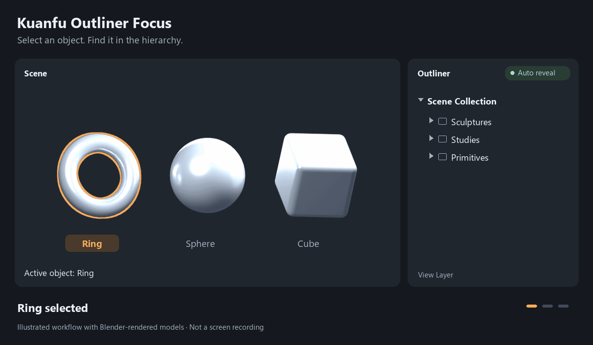

# Kuanfu Outliner Focus

Automatically reveal the active Blender object in the Outliner. Select an object in the viewport and its hierarchy expands and scrolls into view.

在视图中选择物体，Outliner 自动展开层级并定位当前活动物体。

*Blender 实际操作录屏：点击模型，插件自动展开对应集合并定位物体。Actual Blender screen recording with the add-on enabled.*

[Download the MP4 demo / 下载演示视频](https://github.com/kuanfuweimu/kuanfu-outliner-focus/releases/download/v1.0.0/kuanfu-outliner-focus-real-demo.mp4)

## Installation / 安装

1. Download `kuanfu-outliner-focus-v1.0.0.zip` from [Releases](https://github.com/kuanfuweimu/kuanfu-outliner-focus/releases/latest). Use the named installation ZIP, not GitHub's source archive.
2. In Blender Preferences → Add-ons, use **Install from Disk** and select the ZIP.
3. Enable **Kuanfu Outliner Focus** and save preferences if automatic saving is disabled.

下载 Release 中的安装 ZIP，在 Blender 偏好设置 → 插件 → 从磁盘安装，选中 ZIP 后启用插件。

## Usage / 使用

- Select an object in the viewport. The Outliner follows the **active object**; with multiple selections, this is the last active object.
- Toggle automatic following with the target icon in the Outliner header, or **Auto Reveal Selected** in its Filter popover.
- Search for **Reveal Active Object in Outliner** with F3 to reveal manually.
- Preferences include selection synchronization and the polling interval (default 0.25 seconds).

在 Outliner 顶栏或筛选面板中切换自动定位；多选时跟随活动物体。插件不会主动折叠其他集合。

## Compatibility and limitations

- Declared minimum: Blender 4.2. Live-tested on the author's Blender 5.2.2 Octane installation; other versions have not been individually tested.
- Works with Outliners in **View Layer** mode. Filters must allow the object to appear.
- Follows active-object changes, not every change to the full selection set. Selecting the already-active object does not trigger another scroll; use manual reveal if needed.
- Pauses automatic updates during render jobs. Does not modify geometry, materials, or render settings.
- Uses native Blender APIs. No network access or external Python dependencies.

## Development

The installable add-on is `kuanfu_outliner_focus/__init__.py`. Run `./package.ps1` in PowerShell to create the release ZIP and SHA-256 checksum under `dist/`. No Blender binaries, scenes, or personal settings are distributed.

## License

GPL-3.0-or-later. Copyright (c) 2026 Kuanfu.
